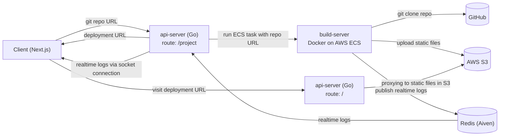

# Relay

> Deploy your React apps with just a click.

Relay is a Vercel-style deployment platform. Paste a Git repository URL, and Relay clones it, builds it inside an isolated container on AWS ECS, uploads the static output to S3, and serves it on a unique deployment URL, while streaming build logs to your browser in real time.


---

## Table of Contents

- [Features](#features)
- [System Architecture](#system-architecture)
- [How It Works](#how-it-works)
- [Tech Stack](#tech-stack)
- [Project Structure](#project-structure)
- [Getting Started](#getting-started)
- [Design Decisions and Tradeoffs](#design-decisions-and-tradeoffs)
- [Roadmap](#roadmap)

---

## Features

- One-step deploys from a public Git repository URL
- Isolated builds: every deployment builds in its own Docker container on AWS ECS
- Real-time build logs streamed to the browser over WebSockets (Redis pub/sub as the log bus)
- Static output stored in S3 and served through a Go reverse proxy
- Clean separation between the control plane (api-server), the build plane (build-server) and the UI (client)

## System Architecture




## How It Works

1. **Submit.** The client sends a Git repo URL to the api-server's `/project` route.
2. **Launch.** The api-server starts an ECS task running the build-server container, passing it the repo URL, and immediately returns a deployment URL to the client.
3. **Build.** Inside the container, the builder clones the repo from GitHub, installs dependencies and builds the project.
4. **Upload.** The builder uploads the static build output to S3.
5. **Stream logs.** Throughout the build, the container publishes log lines to Redis. The api-server subscribes to them and forwards them to the client over a socket connection, which the client renders in a terminal view.
6. **Serve.** When a user opens the deployment URL, the api-server's `/` route acts as a reverse proxy and serves the matching static files straight from S3.

## Tech Stack

| Layer | Technology |
| --- | --- |
| API server | Go 1.23.0 |
| Build server | Go 1.23.0, Docker, AWS ECS |
| Client | Next.js, TypeScript, Tailwind CSS, shadcn/ui |
| Storage | AWS S3 |
| Realtime logs | Redis (hosted on Aiven), WebSockets |

## Project Structure

```
.
├── api-server
│   ├── cmd
│   │   └── server
│   │       └── main.go              # Entry point
│   ├── go.mod
│   ├── go.sum
│   └── internal
│       ├── handlers
│       │   ├── reverseProxy.go      # "/" route: proxies deployed static files from S3
│       │   ├── runEscTask.go        # "/project" route: launches the ECS build task
│       │   └── socketLogs.go        # Streams Redis logs to the client over WebSockets
│       ├── middlewares
│       │   ├── corsPolicy.go        # CORS configuration
│       │   └── redisSetup.go        # Redis client setup
│       └── utils
│           ├── checkError.go        # Error helper
│           └── sharedEnvs.go        # Shared environment variables
├── build-server
│   ├── cmd
│   │   └── builder
│   │       └── main.go              # Clone, build and upload entry point
│   ├── Dockerfile                   # Image that runs on ECS
│   ├── go.mod
│   ├── go.sum
│   ├── internal
│   │   └── upload
│   │       └── uploader.go          # Uploads build output to S3
│   └── script.sh                    # Container entry script
├── client
│   ├── src
│   │   ├── app                      # Next.js app router (layout, page, globals)
│   │   ├── components               # LogTerminal, Navbar, shadcn/ui primitives
│   │   ├── hooks                    # use-toast
│   │   └── lib                      # Shared utilities
│   ├── public                       # Static assets
│   ├── package.json
│   ├── tailwind.config.ts
│   └── tsconfig.json
└── README.md
```

## Getting Started

### Prerequisites

- Go **1.23.0**
- Node.js (or Bun) for the client
- Docker
- An AWS account with an ECS cluster and task definition for the build-server, plus an S3 bucket
- A Redis instance (Aiven or any other provider)

### 1. Build and push the build-server image

```bash
cd build-server
docker build -t relay-build-server .
# Push the image to your registry (e.g. ECR) and reference it in your ECS task definition
```

### 2. Run the api-server

```bash
cd api-server
# Set the environment variables (see below)
go run ./cmd/server
```

### 3. Run the client

```bash
cd client
npm install    # or: bun install
npm run dev    # or: bun dev
```

### Environment variables

The exact names live in `api-server/internal/utils/sharedEnvs.go`. In general you will need:

| Purpose | Used by |
| --- | --- |
| AWS credentials and region | api-server, build-server |
| ECS cluster, task definition, subnets and security groups | api-server |
| S3 bucket name | api-server, build-server |
| Redis connection URL | api-server, build-server |
| API server URL | client |

> A `.env.example` for each service is on the [roadmap](#roadmap).

## Design Decisions and Tradeoffs

- **ECS container per build.** Builds run untrusted user code, so each one gets its own isolated container instead of running on the API host. The tradeoff is cold-start latency and AWS cost, in exchange for isolation and horizontal scalability.
- **Redis as the log bus.** The build container and the API server never talk to each other directly. Logs flow through Redis pub/sub, so the build plane can be scaled or replaced without touching the API. The tradeoff is that pub/sub is fire-and-forget, so logs are not persisted yet (see roadmap).
- **S3 plus a reverse proxy.** Static output is stored cheaply and durably in S3, and the Go proxy maps a deployment to its files. This keeps hosting simple and avoids running one server per deployment. The tradeoff is that the proxy is on the hot path for every request.
- **Go for the backend.** Small static binaries, strong concurrency primitives for streaming logs, and a good fit for infrastructure tooling.

## Roadmap

### Current state (MVP)

- [x] Deploy a React app from a Git repo URL
- [x] Isolated builds in Docker containers on AWS ECS
- [x] Static output uploaded to S3 and served via a Go reverse proxy
- [x] Real-time build logs streamed to the client via Redis and WebSockets

### Phase 1: Production hardening

- [ ] Postgres for projects, deployments and build logs
- [ ] Authentication with ownership-based authorization
- [ ] Per-user build limits and rate limiting
- [ ] GitHub Actions CI
- [ ] docker-compose local mode
- [ ] `.env.example` for each service
- [ ] Idiomatic Go restructure
- [ ] Webhook auto-deploy on push (stretch)

### Phase 2: Microservices MVP

Split the platform into independent services (backend only; the existing client stays as it is for now).

- [ ] GraphQL API gateway as the single entry point
- [ ] gRPC for service-to-service communication
- [ ] Kafka for asynchronous build and deployment events
- [ ] GitHub OAuth login
- [ ] Pick a repo from your GitHub repositories (via the GitHub API) instead of pasting a URL
- [ ] Elasticsearch for searchable build logs
- [ ] Terraform for infrastructure as code (low priority)

### Phase 3: AI build agent

A self-healing build agent that fixes failing deployments.

- [ ] Read the repo and its config, then diagnose failed builds from the logs
- [ ] Propose build-config fixes and retry on ECS with a bounded number of iterations and a cost budget
- [ ] Eval harness: benchmark against roughly 50-100 public repos and compare with a heuristic baseline

### Out of scope (for now)

Custom domains, billing, teams, and Kubernetes.

## # License

This project is licensed under the [MIT License](LICENSE).
